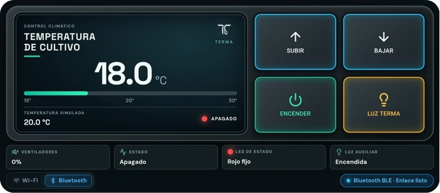

# TERMA · Sistema de Control Climático para Invernaderos


## 1. Descripción General y Propósito del Sistema

TERMA es una plataforma de control climático para invernaderos diseñada para operar de forma autónoma, robusta y **100% offline**. El sistema combina una interfaz táctil de alta respuesta (HMI) desarrollada con **React 19**, **Vite** y **Capacitor 8** —empaquetada como aplicación **Android APK nativa**— con un controlador embebido basado en microcontroladores **ESP32 / ESP32-S3**.

La comunicación entre el terminal táctil y la unidad de control se resuelve mediante una topología de transporte dual en tiempo real: **WebSocket sobre red Wi-Fi local** y **Bluetooth Low Energy (BLE)** mediante la pila NimBLE, garantizando supervisión y comando inmediato sin requerir infraestructura externa de servidores ni conectividad a Internet.

---

## 2. Estado del Desarrollo y Ecosistema Global TERMA

### 2.1 TERMA: Prototipo Funcional de Campo
Es importante destacar que este desarrollo corresponde a un **prototipo funcional de validación experimental y operativa en terreno**, y **no a un producto comercial final**. 

Su objetivo primordial es comprobar la viabilidad técnica, ergonomía de comando y robustez de comunicación gobernando directamente los periféricos físicos reales del módulo:
* Gobernanza de actuadores de potencia (etapa PWM de ventilación a 25 kHz y conmutación de luminarias).
* Señalización óptica perimetral en tiempo real mediante bus WS2812B.
* Enlace de control local inmediato (Wi-Fi WebSocket y BLE punto a punto) en condiciones reales de campo sin acceso a redes externas.

### 2.2 TERMA Central Interface: Maqueta Conceptual del Sistema Automatizado Integral
Como complemento y visión a escala global del ecosistema, el proyecto hermano **TERMA Interface** constituye una **maqueta interactiva de alta fidelidad (prototipo conceptual no funcional)**. Dicha aplicación proyecta cómo se visualizaría y operaría una estación central de control automatizado para la totalidad de una instalación agrícola equipada con múltiples módulos geotérmicos y colectores solares térmicos.

Entre las capacidades modeladas conceptualmente en dicha interfaz destacan:
* **Flujo Térmico en Cascada:** Representación visual del intercambio de energía secuencial: aire exterior captado $\rightarrow$ preacondicionamiento en conductos geotérmicos a 2.5 m de profundidad en el subsuelo $\rightarrow$ transferencia en intercambiadores agua-aire $\rightarrow$ inyección al ambiente de cultivo.
* **Módulo de Geotermia Profunda:** Monitoreo del aprovechamiento de la inercia térmica constante de la tierra mediante pozos canadienses/subterráneos y cálculo de saltos térmicos ($\Delta T$).
* **Circuito Solar Térmico e Hidrónico:** Telemetría de termotanques solares, balance entre ganancia solar pasiva (0W de consumo) y resistencia eléctrica auxiliar modulada para períodos nocturnos o de baja insolación.
* **Control Proporcional Multivariable:** Regulación independiente de caudales de aireación forzada (`fan`), bombas de recirculación de fluidos caloportadores (`pump`) y aportes de calefacción (`heater`).
* **Ciclos de Vida del Sistema y Diagnóstico:** Secuencias completas de inicialización de hardware (*Cold Boot*), arranque con comprobación de periféricos, modo mantenimiento con purgado forzado de bombas y rutinas de apagado seguro.
* **Ergonomía de Operación Contínua:** Modo Standby con salvapantallas tras inactividad (con inmunidad contra toques accidentales al despertar), soporte para bloqueo de pantalla (*Wake Lock*) en terminales fijos y adaptación automática de tema claro/oscuro según reloj solar diurno/nocturno.

> 🌐 **Acceso a la Maqueta Conceptual Desplegada:**  
> [TERMA - INVERNADERO INTELIGENTE](https://terma-taupe.vercel.app)

---

## 3. Arquitectura del Sistema y Separación de Responsabilidades

Para asegurar la integridad del proceso físico y evitar inconsistencias o cálculos concurrentes redundantes, TERMA establece una partición estricta entre la capa de presentación (HMI) y el controlador de tiempo real (Firmware ESP32-S3):

| Dimensión Operativa | Modo Simulación (Evaluación / Offline) | Modo Físico Conectado (ESP32-S3) |
| :--- | :--- | :--- |
| **Fuente de Verdad** | Estado reactivo local (`useClimateControl.js`) | **Firmware embebido en ESP32-S3** |
| **Dinámica Térmica** | Motor físico simulado en frontend (ciclo 550 ms) | Sensores físicos de temperatura y humedad en tiempo real |
| **Control de Ventilación (PWM)** | Cálculo estimativo en interfaz (0% a 100%) | **Generación por hardware LEDC (25 kHz)** |
| **Señalización Visual (LED RGB)** | Renderizado en pantalla según consigna | **Control directo WS2812B por histéresis térmica** |
| **Iluminación Auxiliar** | Conmutación de estado visual | Control de etapa de conmutación / relé |
| **Tolerancia a Fallos de Enlace** | N/A | **Congelamiento de último estado confirmado** (sin disparos espurios) |

---

## 4. Ergonomía y Diseño de la Interfaz Táctil (HMI)



El diseño de la interfaz de usuario está concebido específicamente para terminales móviles y paneles táctiles industriales, priorizando la ergonomía de operación y el aprovechamiento de la superficie útil:

* **Aprovechamiento Integral del Espacio Visual:**  
  La arquitectura visual prescinde de barras de encabezado decorativas o contenedores superiores redundantes, montando el chasis del panel principal (`.housing`) directamente sobre la superficie total del display. Esta disposición maximiza el área destinada a la lectura numérica y a la botonera de control táctil, garantizando legibilidad inmediata tanto en orientación vertical (*portrait*) como horizontal (*landscape*).
* **Gestión de Áreas Seguras del Dispositivo:**  
  La interfaz integra de forma nativa variables CSS de contorno seguro (`safe-area-inset-top`, `safe-area-inset-bottom`, `safe-area-inset-left`, `safe-area-inset-right`), previniendo cualquier solapamiento o conflicto táctil con muescas de pantalla (*notches*), cámaras frontales o barras de navegación del sistema operativo Android.
* **Distribución y Jerarquía de Controles:**
  * **Pantalla Digital:** Visualización de temperatura actual, temperatura consigna, barra de progreso con marcadores de referencia (15°C, 20°C, 30°C) y acceso modal a credenciales de red.
  * **Botonera Táctil:** Comandos de gran superficie de contacto con respuesta háptica para ajuste de consigna (`SUBIR`, `BAJAR`), conmutación de energía (`POWER`) y control de iluminación (`LUZ`).
  * **Panel de Telemetría (InfoBar):** Lectura en tiempo real del ciclo de trabajo de ventilación (% PWM), régimen térmico activo y estado de actuadores.
* **Consola de Conectividad Integrada (SimulationBar):**  
  Ubicada en el zócalo inferior del panel, la barra de conectividad resuelve de forma limpia y accesible:
  * **Sector Izquierdo:** Selectores dedicados de canal de comunicación: botón **Wi-Fi** y botón **Bluetooth (BLE)** para conmutación inmediata de medio.
  * **Sector Derecho:** Indicador dinámico de estado de enlace (Conectado / Desconectado / Reconectando) y gatillo de apertura para el menú de configuración de parámetros y simulación.

---

## 5. Topología y Protocolos de Comunicación

### 5.1 Canal Wi-Fi: WebSocket Concurrente (`ws://192.168.4.1/ws`)
* **Red Inalámbrica Propia:** El microcontrolador ESP32-S3 emite un punto de acceso (Access Point) bajo el SSID `TERMA-TOTEM` con dirección IP fija `192.168.4.1`.
* **Canal Bidireccional:** Comunicación full-duplex vía WebSocket en el endpoint `ws://192.168.4.1/ws`.
* **Tráfico Local en Red Aislada (Cleartext):** Configurado a través de directivas de seguridad Android (`network-security-config`) y esquema HTTP en Capacitor para habilitar tráfico local sin requerir certificados de internet.
* **Enlace de Proceso a Red:** Implementación a nivel nativo en `MainActivity.java` mediante `ConnectivityManager.bindProcessToNetwork`, asegurando que el sistema operativo Android mantenga la ruta de paquetes dirigida al Wi-Fi del tótem y no la desvíe a redes celulares ante la ausencia de conexión a Internet.
* **Concurrencia Multi-Cliente:** Permite el enlace simultáneo de múltiples dispositivos supervisores en paralelo, recibiendo telemetría continua y sincronizando cualquier cambio de estado entre todos los clientes conectados.

---

### 5.2 Canal Bluetooth Low Energy: NimBLE 2.x
Diseñado para la supervisión directa en campo en proximidad física al tótem, sin necesidad de vincularse a una red Wi-Fi:

#### Parámetros del Servicio GATT
* **Nombre de Publicidad (Advertised Name):** `TERMA-CONTROL`
* **GATT Service UUID:** `8d7a0001-31d5-4db4-a9d7-0e3c4b1a7001`
* **Característica RX (Android → ESP32):** `8d7a0002-31d5-4db4-a9d7-0e3c4b1a7001` (Escritura con respuesta)
* **Característica TX (ESP32 → Android):** `8d7a0003-31d5-4db4-a9d7-0e3c4b1a7001` (Notificaciones / Lectura)

#### Modelo de Enlace Exclusivo Punto a Punto (1 a 1)
Por diseño y consideraciones de seguridad operativa:
* La sesión BLE opera bajo exclusividad de canal para un único operador a la vez.
* Al establecerse la conexión con un terminal móvil, el controlador detiene inmediatamente la emisión de paquetes de publicidad (*Advertising*), aislando la sesión y previniendo la mezcla o colisión de búferes de comandos.
* Al terminar o interrumpirse el enlace, el firmware reanuda el *advertising* de forma automática, dejando el sistema inmediatamente disponible para otro operario.

#### Wire-Framing, Fragmentación y Control de Flujo
* **Delimitación de Trama:** Flujo de caracteres UTF-8 estructurados en JSON y finalizados con delimitador de salto de línea `0x0A` (`\n`).
* **Transmisión Fragmentada (App → ESP32):** La capa de transporte divide los mensajes en paquetes continuos de hasta **20 bytes** (MTU legacy estándar), canalizados a través de una cola secuencial (`writeQueue`) con confirmación de escritura por bloque para garantizar la entrega ordenada e íntegra.
* **Recepción y Ensamblado (ESP32 → App):** Las notificaciones entrantes de la característica TX se acumulan en un búfer circular de bytes crudos (`rxBuffer`), disparando el deserializador JSON únicamente tras registrar el byte de fin de línea `\n`.
* **Inicialización Limpia:** La capa cliente gestiona el descarte de mensajes de bienvenida de arranque (`"TERMA ready\n"`) y solicita inmediatamente la sincronización del estado físico (`getState`).

#### Optimización de Latencia y Publicidad
* **Prioridad de Conexión en Alta Velocidad:** La aplicación negocia `ConnectionPriority.CONNECTION_PRIORITY_HIGH` en Android, fijando la ventana de conexión entre `7.5 ms` y `15 ms`.
* **Cadencia de Bombeo de Telemetría:** El firmware ejecuta el envío de fragmentos de notificación con un intervalo de **8 ms**, logrando que la trama completa de estado se transfiera en menos de 75 ms.
* **Estructura de Publicidad Normalizada:** Con el fin de respetar estrictamente la restricción de 31 bytes del estándar BLE Legacy y asegurar que los dispositivos identifiquen el tótem sin demoras ni denominaciones genéricas, el nombre `TERMA-CONTROL` se ubica en el paquete de publicidad primario y los UUIDs de servicio en el paquete de respuesta de escaneo (*Scan Response*).

---

## 6. Especificación del Protocolo de Mensajería JSON

Ambos canales de transporte (WebSocket y BLE) emplean el mismo esquema de serialización JSON con correlación de identificadores:

### Comandos de Control (Terminal → ESP32)
```json
{"action":"setPower","enabled":true,"id":"cmd_1712678900_1"}
{"action":"setTarget","target":23.5,"id":"cmd_1712678900_2"}
{"action":"setLight","light":false,"id":"cmd_1712678900_3"}
{"action":"getState","id":"cmd_1712678900_4"}
```

### Confirmaciones y Acuses de Recibo (ACK)
```json
{"type":"ack","ack":"cmd_1712678900_2","success":true,"status":"ok","message":"Estado actualizado"}
```

### Telemetría de Estado (ESP32 → Terminal)
```json
{"type":"state","targetTemperature":18.5,"actualTemperature":19.4,"power":true,"light":false,"fanSpeed":45,"systemStatus":"enfriando","ledMode":"blink-cyan"}
```

---

## 7. Subsistemas Físicos Gobernados

### 7.1 Etapa de Ventilación de 12V (Modulación PWM a 25 kHz)
* Conexión en paralelo de tres ventiladores de 12V comandados por canal PWM generado por el periférico LEDC del ESP32 a una frecuencia audible imperceptible de **25 kHz**.
* **Estado Apagado:** Ciclo de trabajo al `0%`.
* **Régimen Estable (En Confort):** `30%` constante de recirculación de flujo laminar dentro del invernadero.
* **Régimen Activo (Calentando / Enfriando):** Modulación continua proporcional al gradiente térmico entre `35%` y `100%`:  
  $$\text{fanSpeed} = \text{clamp}(40 + |\Delta T| \times 12,\, 35,\, 100)$$

### 7.2 Señalización Óptica de Estado (LED RGB WS2812B)
Tira direccionable programada para retroalimentación visual perimetral de acuerdo al estado térmico del recinto:
* **Sistema en Espera / Apagado:** Rojo continuo (`red`).
* **Demanda de Calefacción:** Verde intermitente (`blink-green`).
* **Condición de Confort Alcanzada:** Verde continuo (`green`).
* **Demanda de Refrigeración:** Celeste intermitente (`blink-cyan`).
* La línea de iluminación auxiliar de cultivo comanda la etapa de potencia de luminarias manteniendo la independencia de los bucles de control climático.

---

## 8. Estructura del Repositorio

```text
TERMA-totem/
├── TERMA-debug.apk              # Paquete ejecutable Android nativo
├── build-apk.ps1                # Script automatizado de compilación nativa (Gradle + Android SDK)
├── capacitor.config.json        # Configuración de runtime móvil Capacitor 8
├── android/                     # Proyecto nativo Android generado y sincronizado
│   └── app/src/main/
│       ├── AndroidManifest.xml  # Declaración de permisos de red, Wi-Fi, BLE y rotación
│       ├── java/.../MainActivity.java # Flags FLAG_KEEP_SCREEN_ON y anclaje Wi-Fi de bajo nivel
│       └── res/                 # Recursos gráficos y pantallas de arranque (Splash screens)
├── src/
│   ├── main.jsx                 # Punto de entrada de la aplicación React
│   ├── App.jsx                  # Montaje del contenedor principal de la interfaz
│   ├── components/
│   │   ├── Screen.jsx           # Display térmico, marcas de escala y diálogo modal QR
│   │   ├── Controls.jsx         # Botonera táctil interactiva (SUBIR, BAJAR, POWER, LUZ)
│   │   ├── InfoBar.jsx          # Panel de telemetría de actuadores (% PWM, LED, luz)
│   │   └── SimulationBar.jsx    # Consola de conectividad (selectores Wi-Fi/BLE y estado)
│   ├── constants/
│   │   └── climate.js           # Parámetros climáticos, funciones PWM y UUIDs GATT
│   ├── hooks/
│   │   └── useClimateControl.js # Orquestación reactiva de estado y despacho a clientes físicos
│   ├── services/
│   │   ├── esp32Client.js       # Implementación de cliente WebSocket con correlación ACK
│   │   └── esp32BleClient.js    # Implementación de transporte BLE (fragmentación, framing y ACK)
│   └── styles/
│       └── style.css            # Hoja de estilos con soporte para orientación libre y áreas seguras
└── tests/
    ├── climate.test.js          # Pruebas unitarias de física térmica y cálculo de PWM
    ├── esp32Client.test.js      # Pruebas unitarias de conexión y mensajería WebSocket
    └── esp32BleClient.test.js   # Pruebas unitarias de framing, chunks y protocolo BLE
```

---

## 9. Flujo de Compilación y Verificación

```bash
# 1. Ejecución de la suite completa de pruebas unitarias
npm test

# 2. Compilación del bundle web para entorno de producción
npm run build

# 3. Sincronización de recursos y plugins con el contenedor nativo Android
npx cap sync

# 4. Generación del paquete instalable Android APK mediante Gradle
npm run build:apk
```

El proceso de empaquetado genera el archivo ejecutable `TERMA-debug.apk` en la raíz del repositorio, preparado para su despliegue inmediato en terminales Android físicos.
